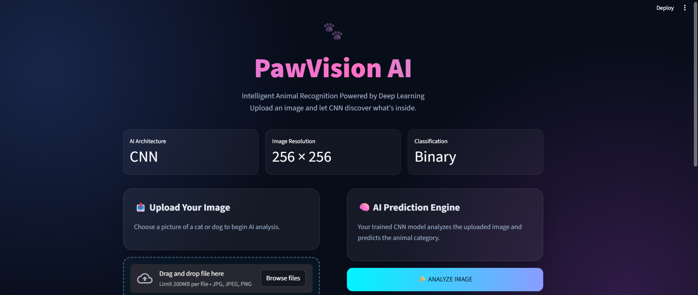
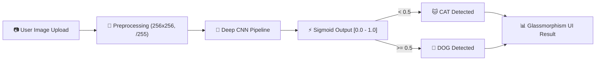
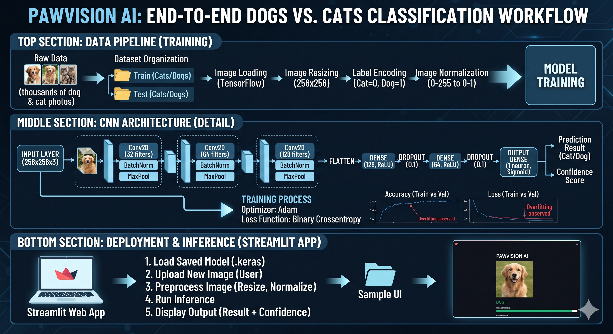
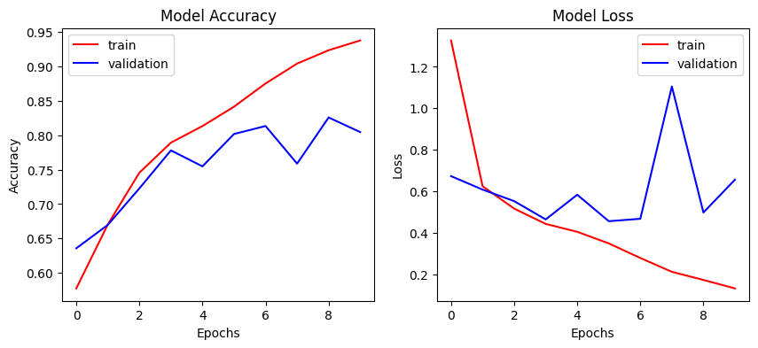

<div align="center">

# 🐾 PawVision AI — Deep Learning Dog vs Cat Classifier

<p align="center">
  
</p>

[](https://python.org)
[](https://tensorflow.org)
[](https://keras.io)
[](https://streamlit.io)
[](https://opencv.org)
[](LICENSE)

<br/>

<p align="center">
  <b>PawVision AI</b> is an end-to-end Deep Learning application that distinguishes between dogs and cats in real-time with high confidence, wrapped in a cyberpunk glassmorphism web interface.
</p>

[✨ Live Features](#-key-features) • [🧠 Neural Architecture](#-neural-network-architecture) • [🚀 Quick Start](#-quick-start) • [📊 Results & Evaluation](#-model-evaluation--training-results) • [🔮 Workflow](#-end-to-end-workflow)

</div>

---

## 📸 Application Previews

<div align="center">

| 🏠 Clean Hero Dashboard | 🎯 Real-Time AI Prediction |
|:---:|:---:|
|  |  |

</div>

---

## ✨ Key Features

- **⚡ Fast Inference**: Instant predictions powered by an optimized Convolutional Neural Network (CNN).
- **🎨 Glassmorphism Dark UI**: Built with Streamlit, custom CSS animations, neon glows, and gradient typography.
- **📊 Real-time Confidence Gauges**: Dynamic prediction progress bars and exact probability scores for both classes.
- **🛡️ Robust Input Handling**: Automatic resizing to 256×256, RGB normalization, and support for JPG, JPEG, and PNG.
- **🧩 Production-Ready Caching**: Leverages `@st.cache_resource` for zero-redundancy model loading.

---

## 🔮 End-to-End Workflow



<div align="center">
  
</div>

---

## 🧠 Neural Network Architecture

The classifier is built using a custom multi-stage **Sequential CNN** trained on Kaggle's Dogs vs Cats dataset.

```
Input Image (256 x 256 x 3)
   │
   ├── [Conv2D: 32 filters (3x3)] ──> [Batch Normalization] ──> [MaxPool2D (2x2)]
   │
   ├── [Conv2D: 64 filters (3x3)] ──> [Batch Normalization] ──> [MaxPool2D (2x2)]
   │
   ├── [Conv2D: 128 filters (3x3)] ──> [Batch Normalization] ──> [MaxPool2D (2x2)]
   │
   ├── [Flatten Layer]
   │
   ├── [Dense: 128 units, ReLU] ──> [Dropout: 0.1]
   │
   ├── [Dense: 64 units, ReLU]  ──> [Dropout: 0.1]
   │
   └── [Dense: 1 unit, Sigmoid] ──> Output Probability
```

<details>
<summary><b>🔍 Click here to view layer specifications</b></summary>

| Layer Type | Filters / Units | Kernel / Pool | Activation | Regularization |
|:---|:---:|:---:|:---:|:---|
| **Conv2D + BatchNorm** | 32 | 3 × 3 | ReLU | Batch Normalization |
| **MaxPooling2D** | — | 2 × 2 (Stride 2) | — | — |
| **Conv2D + BatchNorm** | 64 | 3 × 3 | ReLU | Batch Normalization |
| **MaxPooling2D** | — | 2 × 2 (Stride 2) | — | — |
| **Conv2D + BatchNorm** | 128 | 3 × 3 | ReLU | Batch Normalization |
| **MaxPooling2D** | — | 2 × 2 (Stride 2) | — | — |
| **Flatten** | — | — | — | — |
| **Dense** | 128 | — | ReLU | Dropout (0.1) |
| **Dense** | 64 | — | ReLU | Dropout (0.1) |
| **Output (Dense)** | 1 | — | Sigmoid | Binary Crossentropy |

</details>

---

## 📊 Model Evaluation & Training Results

<div align="center">
  
</div>

<div align="center">

| Metric | Training | Validation |
|:---|:---:|:---:|
| **Loss Function** | Binary Cross-Entropy | Binary Cross-Entropy |
| **Optimizer** | Adam (`lr=0.001`) | Adam |
| **Batch Size** | 32 | 32 |
| **Target Size** | 256 × 256 | 256 × 256 |

</div>

---

## 📁 Repository Structure

```bash
📦 Cat-and-Dog-Classifier
├── 📂 assets
│   ├── 📂 ui                     # Dashboard & prediction screenshots
│   │   ├── homepage.png
│   │   └── prediction page.png
│   ├── 📂 workflow               # Pipeline workflow diagrams
│   │   └── workflow.png
│   ├── graphs.png               # Training accuracy & loss curves
│   ├── cat.jpg                  # Sample test images
│   └── dog.jpg
├── 📂 models
│   └── dog_cat_cnn.keras        # Trained Keras model weights (download/place here)
├── 📂 notebook
│   └── cat_and_dog_classifier.ipynb  # End-to-end training notebook
├── 📄 .gitignore                # Production ignore rules
├── 📄 app.py                    # Streamlit web application
└── 📄 README.md                 # Interactive documentation
```

---

## 🚀 Quick Start

### 1. Clone the Repository
```bash
git clone https://github.com/your-username/cat-and-dog-classifier.git
cd cat-and-dog-classifier
```

### 2. Create and Activate Virtual Environment
```bash
# Windows (PowerShell)
python -m venv venv
.\venv\Scripts\Activate.ps1

# Linux / macOS
python3 -m venv venv
source venv/bin/activate
```

### 3. Install Dependencies
```bash
pip install streamlit tensorflow numpy pillow opencv-python matplotlib
```

### 4. Ensure Model File Exists
Place your trained `dog_cat_cnn.keras` model inside the `models/` directory:
```
models/dog_cat_cnn.keras
```

### 5. Launch the Streamlit App
```bash
streamlit run app.py
```

Navigate to `http://localhost:8501` in your browser to interact with PawVision AI.

---

## ❓ Frequently Asked Questions

<details>
<summary><b>🐱 Why does output < 0.5 indicate Cat?</b></summary>
<p>
The dataset directories are sorted alphabetically by default when imported using <code>tf.keras.utils.image_dataset_from_directory</code>:
<ul>
  <li><b>Class 0</b> = <code>cat</code></li>
  <li><b>Class 1</b> = <code>dog</code></li>
</ul>
Hence, predictions closer to 0 represent cats, while values closer to 1 represent dogs.
</p>
</details>

<details>
<summary><b>⚡ Can I run this with GPU acceleration?</b></summary>
<p>
Yes! On Linux/macOS or WSL2 on Windows, TensorFlow automatically utilizes CUDA-compatible GPUs. On native Windows, TensorFlow versions 2.11+ run efficiently on multi-core CPUs via oneDNN.
</p>
</details>

<details>
<summary><b>📦 Why are <code>.keras</code> and <code>.zip</code> files in .gitignore?</b></summary>
<p>
GitHub restricts single file uploads larger than 100MB. The trained model is ~178MB and the dataset archive is ~1.14GB. Use Git LFS or external cloud storage releases to distribute heavy weights.
</p>
</details>

---

## 📄 License

Distributed under the **MIT License**. See `LICENSE` for more information.

<div align="center">
  <sub>Built with ❤️ using TensorFlow, Keras, and Streamlit. Star ⭐ this repository if you found it useful!</sub>
</div>

